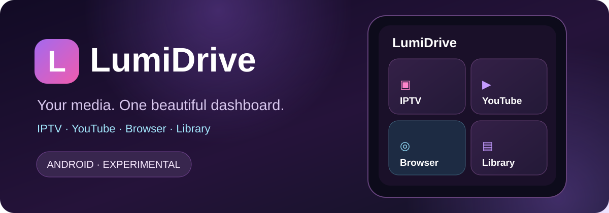

### ✦ Your media. One beautiful dashboard.
### Твои медиа. Один красивый главный экран.

**A modern, experimental Android multimedia experience.**  
**Современный экспериментальный медиаплеер для Android.**

[🇬🇧 English](#-english) · [🇷🇺 Русский](#-русский) · [Latest development branch](https://github.com/serge9900/LumiDrive-build/tree/lumidrive-v0.7.0-updater) · [Builds / APK](https://github.com/serge9900/LumiDrive-build/actions) · [Developer](https://github.com/serge9900)

---

## 🇬🇧 English

**LumiDrive** is an independent Android multimedia project by **Sergey Vardanyan**, built on the open-source [Fermata Media Player](https://github.com/AndreyPavlenko/Fermata) project. It brings media features together behind a fresh, dark-purple phone interface with rounded cards and cyan, pink and violet accents.

The project is **experimental**. It is not an official Fermata or Binance product.

### ✨ What you can do

- 📺 **IPTV:** Open live TV and M3U playlists, with existing TV source and EPG options.
- ▶️ **YouTube:** Access the existing YouTube module from the home screen.
- 🌐 **Web browser:** Open web pages without leaving the media experience.
- 📁 **Media library:** Browse local folders, media files and playlists.
- 💜 **Favorites:** Quickly revisit saved items.
- ⏯️ **Continue watching:** Return to the current or previously played media when available.
- 🏠 **LumiDrive Home:** A custom card dashboard, accessible again through **Home** in the bottom navigation's overflow menu.
- 🚘 **Android Auto variant:** Built using the upstream Auto modules; compatibility depends on the phone, Android Auto version and car head unit.

### 🎨 Design

The LumiDrive phone interface uses a deep-purple background, rounded tiles, modern icons and bright accent colors. Main dashboard labels are in Russian, with English fallback resources. Playback and settings retain parts of the upstream interface while the redesign continues.

### 🚀 Get the latest preview APK

> **Latest development preview: `v0.7.0 (276)`.** Source changes live on [`lumidrive-v0.7.0-updater`](https://github.com/serge9900/LumiDrive-build/tree/lumidrive-v0.7.0-updater). The default `main` branch still contains the older **v0.3 build tools**. This is **not** a verified public release.

1. Open **[GitHub Actions → Build LumiDrive APK](https://github.com/serge9900/LumiDrive-build/actions/workflows/build-lumidrive.yml)**.
2. Open a successful run for the `lumidrive-v0.7.0-updater` branch, or choose **Run workflow** and select that branch.
3. In the run summary, find **Artifacts** and download `LumiDrive-v0.7.0-APK-arm64`.
4. Extract the ZIP and install `LumiDrive-v0.7.0-arm64.apk` on a compatible Android phone.
5. Test IPTV, YouTube, browser and navigation on the phone first. Test Android Auto only while safely parked.

**In-app updates (new in v0.7.0):** After installing this preview once, LumiDrive can check our **published GitHub Releases** at app start (at most daily) or manually under **Settings → Other → Check for LumiDrive updates now**. If a newer release has a matching APK, it prompts before downloading, then opens Android's installation confirmation. Actions Artifacts are NOT update releases; the APK must be attached to a published stable GitHub Release. Read the [update/publishing guide](https://github.com/serge9900/LumiDrive-build/blob/lumidrive-v0.7.0-updater/docs/UPDATING.md).

**Signature compatibility:** An APK can update your existing LumiDrive installation only if the package ID and signing certificate match, and versionCode increases. Earlier test builds used a publicly distributed development signing key; do not use that key for a production launch. Migrating to a private signing key will require one careful reinstall after backing up playlists and settings.

**No Android Studio needed** to download an existing CI build. GitHub Actions artifacts are temporary and require GitHub access.

### 🛠️ Build from source

The build workflow checks out **Fermata 2.0.2**, its submodules and this repository's LumiDrive modifications, then compiles an Android APK using Gradle and Java 17.

- **[`apply_lumidrive.py` — branding and code patches](https://github.com/serge9900/LumiDrive-build/blob/lumidrive-v0.7.0-updater/apply_lumidrive.py)**
- **[`src/LumiDriveDashboard.java` — LumiDrive phone dashboard](https://github.com/serge9900/LumiDrive-build/blob/lumidrive-v0.7.0-updater/src/LumiDriveDashboard.java)**
- **[`build-lumidrive.yml` — automated APK build](https://github.com/serge9900/LumiDrive-build/blob/lumidrive-v0.7.0-updater/.github/workflows/build-lumidrive.yml)**

This repository contains **LumiDrive's patch/build sources**, not a complete standalone copy of Fermata or a permanently hosted APK. The pinned upstream source is downloaded as part of the build.

### ⚠️ Current limitations

- Android Auto behavior is **not guaranteed** on every phone or vehicle.
- Android Auto safety and driver-distraction restrictions still apply; don't use video while driving.
- This is an evolving project. Individual modules and device combinations may need further testing.
- The upstream base and third-party dependencies must be reviewed for license compliance before distributing binaries more broadly.

---

## 🇷🇺 Русский

**LumiDrive** — независимый мультимедийный проект для Android от **Сергея Варданяна**, основанный на открытом проекте [Fermata Media Player](https://github.com/AndreyPavlenko/Fermata). Яркий современный интерфейс объединяет основные функции плеера в одном красивом главном экране.

Проект пока находится **в стадии разработки и тестирования**.

### ✨ Возможности

- 📺 **IPTV:** телеканалы, M3U-плейлисты, настройки источников и EPG.
- ▶️ **YouTube:** переход в существующий модуль YouTube.
- 🌐 **Браузер:** просмотр сайтов прямо из приложения.
- 📁 **Медиатека:** локальные файлы, папки и плейлисты.
- 💜 **Избранное:** быстрый доступ к сохранённому.
- ⏯️ **Продолжить просмотр:** возвращение к текущему или последнему медиа, если оно доступно.
- 🏠 **Главная:** фирменные карточки LumiDrive и возврат через пункт **«Главная»** в раскрывающемся меню нижней панели.
- 🚘 **Android Auto:** отдельная сборка с автомобильными модулями исходного проекта; совместимость зависит от устройства и автомобиля.

### 🎨 Интерфейс

Тёмно-фиолетовый фон, мягкие градиенты, округлые карточки, голубые, розовые и сиреневые акценты. Главный экран уже оформлен в стиле LumiDrive. Остальные экраны постепенно обновляются с сохранением функций плеера.

### 📦 Как скачать и установить

1. Перейди в **[GitHub Actions → Build LumiDrive APK](https://github.com/serge9900/LumiDrive-build/actions/workflows/build-lumidrive.yml)**.
2. Выбери успешную сборку ветки `lumidrive-v0.7.0-updater`. Если сборки нет, нажми **Run workflow** и выбери эту ветку.
3. Внизу страницы, в разделе **Artifacts**, скачай архив `LumiDrive-v0.7.0-APK-arm64`.
4. Распакуй ZIP и установи `LumiDrive-v0.7.0-arm64.apk` на Android-телефон с подходящей архитектурой.
5. Сначала проверь функции на телефоне, затем — Android Auto в припаркованном автомобиле.

**Важно:** текущая экспериментальная версия — **0.7.0 (282)**, исходный код — в отдельной ветке разработки. Ветка `main` пока содержит сборочные инструменты старой v0.3.

**Автообновления появились в v0.7.0.** После однократной установки этой версии LumiDrive будет проверять **опубликованные GitHub Releases** при запуске на телефоне (не чаще раза в сутки). Также можно нажать **Настройки → Другое → Проверить обновления LumiDrive**. Когда появится более новая опубликованная версия, LumiDrive предложит скачать APK и запустит системное подтверждение установки Android.

**Важно:** файлы в GitHub Actions → Artifacts не считаются опубликованными обновлениями. Необходим именно GitHub Release с прикреплённым APK. Подробности: [как работает обновление и публикация](https://github.com/serge9900/LumiDrive-build/blob/lumidrive-v0.7.0-updater/docs/UPDATING.md).

Если Android не позволяет установить APK поверх прежней версии, проверь подпись приложения и идентификатор пакета. Предыдущие тестовые сборки использовали общедоступный ключ подписи Fermata — для публичного выпуска нужен собственный приватный ключ, а переход на него потребует однократной переустановки. Перед этим сохрани плейлисты и настройки.

### 🔧 Исходники и разработка

Для сборки используются исходники **Fermata 2.0.2** и собственные изменения LumiDrive. Всё выполняется через GitHub Actions, поэтому для скачивания APK Android Studio не требуется.

Полезные файлы: [скрипт изменений](https://github.com/serge9900/LumiDrive-build/blob/lumidrive-v0.7.0-updater/apply_lumidrive.py), [главный экран](https://github.com/serge9900/LumiDrive-build/blob/lumidrive-v0.7.0-updater/src/LumiDriveDashboard.java), [сборка GitHub Actions](https://github.com/serge9900/LumiDrive-build/blob/lumidrive-v0.7.0-updater/.github/workflows/build-lumidrive.yml).

### ⚠️ Что важно знать

LumiDrive пока не является стабильным релизом. Не все модели телефонов и автомобильных экранов проверены. Приложение не отменяет ограничения безопасности Android Auto. Пользоваться видео за рулём нельзя.

---

### 🛡️ Diagnostics / Диагностика

- **Privacy-safe logs / Защита данных:** LumiDrive masks URLs and typical access tokens before writing logs; legacy log content is sanitized again when viewed or shared.
- **In-app viewer / Просмотр:** Settings → Other → View LumiDrive log provides filters (all, errors, warnings, Android Auto/media, web, IPTV), Copy and Share.
- **Better troubleshooting / Удобная отладка:** extra Android Auto connection and playback events, plus summarized/deduplicated browser errors. Device-specific testing is still needed.

## ⚖️ Open source & credits · Исходный код и авторство

**LumiDrive UI and modifications / Интерфейс и изменения LumiDrive:** [Sergey Vardanyan](https://github.com/serge9900).

**Upstream / Основа:** [Fermata Media Player](https://github.com/AndreyPavlenko/Fermata) — **Andrey Pavlenko and contributors / Андрей Павленко и участники проекта**.

**License / Лицензия:** **GNU GPL-3.0**. Original copyright notices and applicable license obligations must be retained. Distributions of binaries must provide the corresponding complete source and necessary modifications. Third-party binary dependencies may have additional obligations.

LumiDrive is an independent derivative project; it is **not officially affiliated** with Fermata, Google, Android Auto or Binance.

---

## 💛 Support LumiDrive · Поддержать LumiDrive

**Enjoy LumiDrive? You can support its development with a voluntary donation.**  
**Нравится LumiDrive? Можешь поддержать дальнейшую разработку добровольным донатом.** 💜

### [💛 Donate via Binance Pay · Поддержать через Binance Pay](https://app.binance.com/uni-qr/Jv3MYVZ8)

**Recipient / Получатель:** `User-92ef9`

Open the link in Binance or scan the QR code using the Binance app. 
Открой ссылку в Binance или отсканируй QR-код через приложение Binance.

Donations are optional. Verify the recipient and payment details in Binance before confirming. 
Поддержка добровольная. Перед отправкой проверь получателя и данные перевода в Binance.

---

**Made with 💜 by [Sergey Vardanyan](https://github.com/serge9900)**  
*LumiDrive · Experimental Android multimedia project · Preview v0.7.0*

