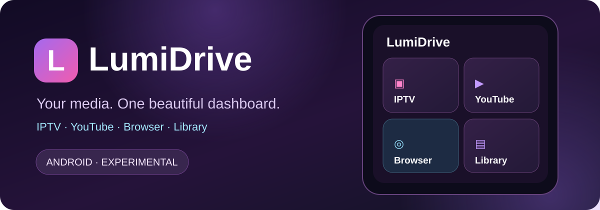

### ✦ Your media. One beautiful dashboard.
### Твои медиа. Один красивый главный экран.

**A modern, experimental Android multimedia experience.**  
**Современный экспериментальный медиаплеер для Android.**

[🌐 Official LumiDrive website](https://serge9900.github.io/LumiDrive-build/) · [🇬🇧 English](#-english) · [🇷🇺 Русский](#-русский) · [⬇ Latest APK](https://github.com/serge9900/LumiDrive-build/releases/latest) · [Source / Builds](https://github.com/serge9900/LumiDrive-build/tree/lumidrive-v0.7.11-world-tv) · [Developer](https://github.com/serge9900)

---

## 🇬🇧 English

**LumiDrive** is an independent Android multimedia project by **Sergey Vardanyan**, built on the open-source [Fermata Media Player](https://github.com/AndreyPavlenko/Fermata) project. It brings media features together behind a fresh, dark-purple phone interface with rounded cards and cyan, pink and violet accents.

The project is **experimental**. It is not an official Fermata or Binance product.

### ✨ What you can do

- 📺 **IPTV:** World channels by country, personal M3U playlists, source settings and EPG.

**Channel catalog credit:** LumiDrive uses country channel playlists from [IPTV-org](https://github.com/iptv-org/iptv), distributed under the [Unlicense](https://github.com/iptv-org/iptv/blob/master/LICENSE). Thanks to its authors and contributors. Open **IPTV → Add → World channels** to search for a country and save its playlist. Personal playlists can still be added by URL or file. Some streams may be unavailable or region restricted.
- ▶️ **YouTube:** Access the existing YouTube module from the home screen.
- 🌐 **Web browser:** Open web pages without leaving the media experience.
- 📁 **Media library:** Browse local folders, media files and playlists.
- 💜 **Favorites:** Quickly revisit saved items.
- ⏯️ **Continue watching:** Return to the current or previously played media when available.
- 🏠 **LumiDrive Home:** A custom card dashboard, accessible again through **Home** in the bottom navigation's overflow menu.
- 🚘 **Android Auto variant:** Built using the upstream Auto modules; compatibility depends on the phone, Android Auto version and car head unit.

### 🎨 Design

The LumiDrive phone interface uses a deep-purple background, rounded tiles, modern icons and bright accent colors. Main dashboard labels are in Russian, with English fallback resources. Playback and settings retain parts of the upstream interface while the redesign continues.

### 🚀 Get the latest LumiDrive APK

**Latest published release:** [LumiDrive v0.7.11 (294)](https://github.com/serge9900/LumiDrive-build/releases/latest). The app's first-party updater checks published GitHub Releases, not temporary GitHub Actions artifacts.

1. Open **[GitHub Releases → Latest](https://github.com/serge9900/LumiDrive-build/releases/latest)**.
2. Under **Assets**, download the official `LumiDrive-v0.7.11-arm64.apk` (or use the in-app update checker).
3. Install on a compatible ARM64 Android device. To update, install **over** an existing LumiDrive copy with the same signing certificate.
4. Check IPTV, browser and media playback on your phone before trying Android Auto while parked.

The source for the latest APK is in [`lumidrive-v0.7.11-world-tv`](https://github.com/serge9900/LumiDrive-build/tree/lumidrive-v0.7.11-world-tv). The `main` branch hosts this website and the repository documentation.

**Website:** [serge9900.github.io/LumiDrive-build/](https://serge9900.github.io/LumiDrive-build/) · [English site](https://serge9900.github.io/LumiDrive-build/en/). GitHub Pages must be enabled under **Settings → Pages → Deploy from a branch → main /docs** before these site links become live.

### 🛠️ Build from source

The build workflow checks out **Fermata 2.0.2**, its submodules and this repository's LumiDrive modifications, then compiles an Android APK using Gradle and Java 17.

- **[`apply_lumidrive.py` — branding and code patches](https://github.com/serge9900/LumiDrive-build/blob/lumidrive-v0.7.11-world-tv/apply_lumidrive.py)**
- **[`src/LumiDriveDashboard.java` — LumiDrive phone dashboard](https://github.com/serge9900/LumiDrive-build/blob/lumidrive-v0.7.11-world-tv/src/LumiDriveDashboard.java)**
- **[`build-lumidrive.yml` — automated APK build](https://github.com/serge9900/LumiDrive-build/blob/lumidrive-v0.7.11-world-tv/.github/workflows/build-lumidrive.yml)**

This repository contains **LumiDrive's patch/build sources**, not a complete standalone copy of Fermata or a permanently hosted APK. The pinned upstream source is downloaded as part of the build.

### ⚠️ Current limitations

- Android Auto behavior is **not guaranteed** on every phone or vehicle.
- Android Auto safety and driver-distraction restrictions still apply; don't use video while driving.
- This is an evolving project. Individual modules and device combinations may need further testing.
- The upstream base and third-party dependencies must be reviewed for license compliance before distributing binaries more broadly.

---

## 🇷🇺 Русский

**LumiDrive** — независимый мультимедийный проект для Android от **Сергея Варданяна**, основанный на открытом проекте [Fermata Media Player](https://github.com/AndreyPavlenko/Fermata). Яркий современный интерфейс объединяет основные функции плеера в одном красивом главном экране.

Проект пока находится **в стадии разработки и тестирования**.

### ✨ Возможности

- 📺 **IPTV:** «Каналы мира» по странам, свои M3U-плейлисты, настройки источников и EPG.

**Источник каталога каналов:** в LumiDrive используются списки каналов по странам проекта [IPTV-org](https://github.com/iptv-org/iptv), распространяемые по лицензии [Unlicense](https://github.com/iptv-org/iptv/blob/master/LICENSE). Спасибо авторам и участникам проекта! Откройте **IPTV → кнопка добавления → «Каналы мира»**, найдите страну и сохраните её плейлист. Свои источники по ссылке или из файла можно добавлять как раньше. Некоторые трансляции могут быть недоступны или ограничены по региону.
- ▶️ **YouTube:** переход в существующий модуль YouTube.
- 🌐 **Браузер:** просмотр сайтов прямо из приложения.
- 📁 **Медиатека:** локальные файлы, папки и плейлисты.
- 💜 **Избранное:** быстрый доступ к сохранённому.
- ⏯️ **Продолжить просмотр:** возвращение к текущему или последнему медиа, если оно доступно.
- 🏠 **Главная:** фирменные карточки LumiDrive и возврат через пункт **«Главная»** в раскрывающемся меню нижней панели.
- 🚘 **Android Auto:** отдельная сборка с автомобильными модулями исходного проекта; совместимость зависит от устройства и автомобиля.

### 🎨 Интерфейс

Тёмно-фиолетовый фон, мягкие градиенты, округлые карточки, голубые, розовые и сиреневые акценты. Главный экран уже оформлен в стиле LumiDrive. Остальные экраны постепенно обновляются с сохранением функций плеера.

### 📦 Скачать и установить LumiDrive

**Последняя опубликованная версия:** [LumiDrive 0.7.11 (294)](https://github.com/serge9900/LumiDrive-build/releases/latest). Приложение проверяет обновления в **GitHub Releases**, а не в промежуточных файлах GitHub Actions.

1. Открой **[GitHub Releases → Latest](https://github.com/serge9900/LumiDrive-build/releases/latest)**.
2. В разделе **Assets** скачай официальный `LumiDrive-v0.7.11-arm64.apk` или обновись через настройки LumiDrive.
3. Установи APK **поверх** текущей версии с совместимой подписью, не удаляя плейлисты и настройки.
4. Проверь работу плеера и браузера сначала на телефоне. В автомобиле тестируй только на стоянке.

Исходники последней версии — ветка [`lumidrive-v0.7.11-world-tv`](https://github.com/serge9900/LumiDrive-build/tree/lumidrive-v0.7.11-world-tv). В `main` находятся сайт, README и базовые сборочные инструменты.

**Официальный сайт:** [serge9900.github.io/LumiDrive-build/](https://serge9900.github.io/LumiDrive-build/). Перед открытием ссылки нужно один раз включить GitHub Pages: **Settings → Pages → Deploy from a branch → main /docs**.

### 🔧 Исходники и разработка

Для сборки используются исходники **Fermata 2.0.2** и собственные изменения LumiDrive. Всё выполняется через GitHub Actions, поэтому для скачивания APK Android Studio не требуется.

Полезные файлы: [скрипт изменений](https://github.com/serge9900/LumiDrive-build/blob/lumidrive-v0.7.11-world-tv/apply_lumidrive.py), [главный экран](https://github.com/serge9900/LumiDrive-build/blob/lumidrive-v0.7.11-world-tv/src/LumiDriveDashboard.java), [сборка GitHub Actions](https://github.com/serge9900/LumiDrive-build/blob/lumidrive-v0.7.11-world-tv/.github/workflows/build-lumidrive.yml).

### ⚠️ Что важно знать

LumiDrive пока не является стабильным релизом. Не все модели телефонов и автомобильных экранов проверены. Приложение не отменяет ограничения безопасности Android Auto. Пользоваться видео за рулём нельзя.

---

## ⚖️ Open source & credits · Исходный код и авторство

**LumiDrive UI and modifications / Интерфейс и изменения LumiDrive:** [Sergey Vardanyan](https://github.com/serge9900).

**Upstream / Основа:** [Fermata Media Player](https://github.com/AndreyPavlenko/Fermata) — **Andrey Pavlenko and contributors / Андрей Павленко и участники проекта**.

**License / Лицензия:** **GNU GPL-3.0**. Original copyright notices and applicable license obligations must be retained. Distributions of binaries must provide the corresponding complete source and necessary modifications. Third-party binary dependencies may have additional obligations.

LumiDrive is an independent derivative project; it is **not officially affiliated** with Fermata, Google, Android Auto or Binance.

---

## 💛 Support LumiDrive · Поддержать LumiDrive

**Enjoy LumiDrive? You can support its development with a voluntary donation.**  
**Нравится LumiDrive? Можешь поддержать дальнейшую разработку добровольным донатом.** 💜

### [💛 Donate via Binance Pay · Поддержать через Binance Pay](https://app.binance.com/uni-qr/Jv3MYVZ8)

**Recipient / Получатель:** `User-92ef9`

Open the link in Binance or scan the QR code using the Binance app. 
Открой ссылку в Binance или отсканируй QR-код через приложение Binance.

Donations are optional. Verify the recipient and payment details in Binance before confirming. 
Поддержка добровольная. Перед отправкой проверь получателя и данные перевода в Binance.

---

**Made with 💜 by [Sergey Vardanyan](https://github.com/serge9900)**  
*LumiDrive · Experimental Android multimedia project · Latest Release v0.7.11*

